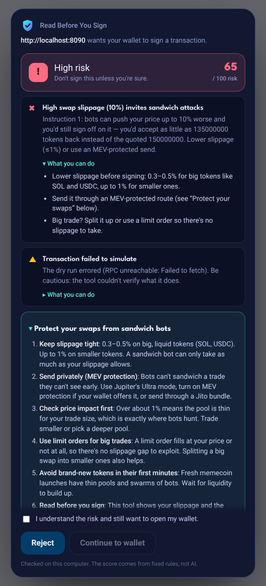
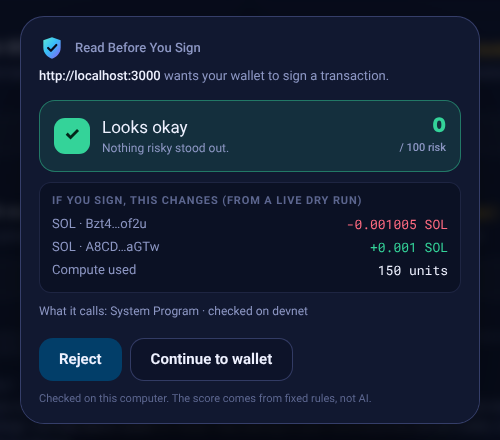

<p align="center">
  
</p>

<h1 align="center">Read Before You Sign</h1>

<p align="center">
  <b>Know what you sign, before you sign.</b><br>
  A Solana wallet guard that dry-runs every transaction, explains it in plain English,<br>
  and tells you what to do about the risky parts before your wallet even opens.
</p>

<p align="center">
  <a href="#-demo">Demo</a> ·
  <a href="#-quick-start">Quick start</a> ·
  <a href="#-how-it-works">How it works</a> ·
  <a href="#-how-solana-and-ai-each-do-real-work">Solana + AI</a> ·
  <a href="docs/DEMO.md">Demo script</a>
</p>

<p align="center">
  Built at the <b>MLH Solana Hackathon</b> (Nov 6–8, 2026) · <b>AI Track</b> · also entered in Top 3 Overall
</p>

---

## 💡 The problem

Every Solana wallet popup asks you to trust a button. Drainer sites exploit
that: the button says **"Claim airdrop"**, but the transaction says *give this
stranger unlimited permission to spend your tokens*. On swaps, a loose
slippage setting quietly hands money to **sandwich bots**. Wallets show a
summary, but they rarely explain the dangerous part or what to do about it.

## ✅ What it does

| | |
| --- | --- |
| 🛡️ **Steps in before the wallet** | A Chrome extension catches sign requests from any Solana site (Phantom, Solflare, Backpack, any wallet-adapter site) and shows a review first. The wallet only opens if you click **Continue**. |
| 🔬 **Live dry run on Solana** | Simulates the transaction against real chain state and shows exactly what would change: balances, new spenders, new owners. |
| 🚩 **Flags real attack patterns** | Unlimited token approvals, token-account handovers, unknown programs, addresses on the community blocklist, swaps with no price protection. |
| 🥪 **Sandwich-attack exposure** | Reads the slippage from Jupiter and Raydium swaps: *"a bot could take up to 10%: you'd accept 135 instead of the quoted 150."* |
| 🧭 **Tells you what to do** | Every warning comes with **"What you can do"** steps, and every swap with a **"Protect your swaps"** checklist. |
| ⛓️ **On-chain scam registry** | A Rust/Anchor program on devnet stores a shared, auditable blocklist. Every checker reads the same list straight from Solana. |
| 🤖 **Plain-English explanations** | AI turns the findings into a short explanation. It can't change the score or call something safe. |

Also included: a web checker and a `rbys` terminal command on the same engine,
plus a **Trade** page that reads your wallet (via Helius) and shows how to
protect your swaps.

## 🎬 Demo

> 📹 **Video:** _add your link here_

<p align="center">
  
  
</p>

The full 2-minute recording script, with timings and a submission checklist,
is in **[docs/DEMO.md](docs/DEMO.md)**.

## ⚡ Quick start

### Just the extension (no setup, no server)

1. Download `read-before-you-sign-extension.zip` from
   [Releases](../../releases) (or use the `extension/` folder of this repo) and unzip it.
2. Open `chrome://extensions` → turn on **Developer mode** → **Load unpacked** → choose the folder.
3. Pin the 🛡️ icon, click it, pick **Devnet** (testing) or **Mainnet** (real funds).

The checker is built into the extension. Nothing else needs to run.

### Everything (web app, CLI, Rust program)

```bash
git clone https://github.com/karlagisq/read-before-you-sign.git
cd read-before-you-sign/app
npm install
cp .env.example .env.local    # optional keys: REGISTRY_PROGRAM_ID, ANTHROPIC_API_KEY, HELIUS_API_KEY
npm run dev                   # http://localhost:3000  (checker, Trade, Demo dApp)
npm link                      # adds the `rbys` terminal command
npm run build:ext             # rebuild the extension after changing app/src/lib
```

```bash
cd ../programs                # the Anchor program (Rust)
npm install
anchor build && anchor keys sync && anchor build && anchor test
anchor deploy --provider.cluster devnet
```

New to Solana? The [Solana Quick Install Guide](https://solana.com/docs/intro/installation)
sets up Rust, the Solana CLI and Anchor in one command (on Windows, inside WSL).

### Live demo on devnet (real dry runs)

```bash
# needs a little devnet SOL: https://faucet.solana.com (command-line airdrops are off on devnet)
cd programs && npm run devnet-fixtures
```

This creates a test token and accounts **in your own devnet wallet** and saves
four unsigned sample transactions. Open **localhost:3000/demo** → **Use demo
wallet** → **Live on devnet**. Every review now shows a real dry-run result.
Details in [docs/DEMO.md](docs/DEMO.md).

## 🧠 How it works

```
 any Solana site asks your wallet to sign
                │
                ▼
 extension pauses the request ─► built-in analyzer
                │                 1. decode instructions (+ swap slippage)
                │                 2. simulate on Solana, diff accounts before/after
                │                 3. read the on-chain scam registry (Anchor program)
                │                 4. deterministic risk rules → score + flags + advice
                │                 5. AI rewords the findings (web app, optional)
                ▼
 review panel:  [ Reject ]  [ Continue to wallet ] ─► wallet opens only if you continue
```

| Part | Where | What it is |
| --- | --- | --- |
| Browser extension | `extension/` | Manifest V3. `inject.js` wraps Wallet Standard and injected-provider signing; `bridge.js` draws the review panel; `src/background.ts` is the analyzer, bundled to `dist/`. |
| Analyzer engine | `app/src/lib/` | `decode.ts`, `swaps.ts`, `simulate.ts`, `registry.ts`, `risk.ts`, `guidance.ts`, `explain.ts`. One engine shared by the extension, web app and CLI. |
| Web app | `app/src/app/` | Next.js 15: `/` checker, `/trade` wallet snapshot + swap protection, `/demo` labeled demo dApp, `/extension` install guide. |
| CLI | `app/src/cli.ts` | `rbys`: colored terminal reports, pipes, JSON, exit codes `0/2/3` for scripts. |
| Scam registry | `programs/` | Rust/Anchor program: PDAs per flagged address, authority-gated writes. Tests + scripts to flag addresses and build demo transactions. |
| Design | `design/` | Logo mark, theme tokens synced with the [Figma file](https://www.figma.com/design/eQb0odQV1cuzZn1kdQjwgs), `apply-tokens.mjs`. |

## 🔗 How Solana and AI each do real work

**Solana does the detection.** It isn't bolted on:

- **`simulateTransaction` against live chain state.** We diff every writable
  account before and after (SPL token layout: amount, delegate, owner), so
  findings reflect what the transaction *really* does, not what the site claims.
- **An on-chain program we wrote.** The scam registry is an Anchor program
  ([`Be5rVJ…HkYcH` on devnet](https://explorer.solana.com/address/Be5rVJnyzJHtnAQKzim6wDGFFgEigJXb2pA7oZ9HkYcH?cluster=devnet))
  storing one PDA per flagged address. Any app can read it with one
  `getProgramAccounts` call: shared, verifiable, composable.
- **Solana's speed makes it practical.** A dry run settles in well under a
  second and costs nothing, so we can check *every* transaction without
  slowing you down.
- **Native wallet integration** through the Wallet Standard, so it works
  across Phantom, Solflare, Backpack and wallet-adapter sites.

**AI does the explaining, and only that.** The risk score and flags come from
deterministic rules plus the simulation. The AI (Claude) receives those
structured findings and turns them into a short plain-English explanation for
non-experts. By design it **cannot change the verdict or declare something
safe**: a security tool shouldn't be talked out of a warning. The extension
uses fixed wording by default, so no transaction data goes to an AI service
from your browser.

## 🥪 Sandwich attacks, explained

A bot spots your swap before it lands, buys just *before* you (pushing the
price up), lets your swap fill at the worse price, then sells just *after* you
and keeps the difference. Solana has no public mempool, but sandwiching still
happens through bundles, cooperating validators and leaky RPCs.

**The bot can only take as much as your slippage allows**, and slippage is
written into the transaction, so we read it before you sign:

| Swap setting | What you see |
| --- | --- |
| Slippage ≤ 1% | ℹ️ the most a sandwich could take |
| Slippage > 1% | ⚠️ "High swap slippage invites sandwich attacks" |
| Slippage ≥ 5% | ⛔ high risk |
| Minimum out = 0 | ⛔ "No price protection" |

Then the **Protect your swaps** checklist: keep slippage tight (0.3–0.5% on
big tokens), send privately (Jupiter Ultra, wallet MEV protection, or a Jito
bundle), check price impact, use limit orders for big trades, and avoid
brand-new tokens in their first minutes.

> **Honest limit:** we don't stop the bot (it acts after you sign). We show
> your exposure and how to remove it, *before* you sign.

## 🔒 Privacy & security

- **Advisory only.** The extension holds no keys, can't sign, and never changes
  a transaction. It pauses or rejects; your wallet still asks you to approve.
- **Nothing leaves your computer** except the dry run to a Solana RPC, the same
  thing your wallet does for its own preview. Custom RPCs are opt-in per host.
- **Tamper-resistant panel:** closed shadow root, accepts only real clicks, and
  shows the site's origin as Chrome reports it. High risk locks **Continue**
  until you tick "I understand the risk".
- **No secrets in the repo.** API keys live in `.env.local` (gitignored); the
  Helius key stays server-side.

## 🛠️ Tech stack

Solana (`@solana/web3.js`, `@solana/spl-token`, Wallet Standard, wallet-adapter) ·
Rust + Anchor 0.31 · TypeScript · Next.js 15 / React 18 · Chrome Manifest V3 ·
esbuild · Helius DAS · Claude (Anthropic API) · Figma · League Spartan, Roboto

## 🚧 Limitations & what's next

**Known limits:** address-lookup-table accounts aren't resolved yet;
slippage is read for Jupiter v6 and Raydium AMM v4 only; the registry is
authority-gated; a site written specifically to evade the extension could
bypass it (true of every wallet guard).

**Next:** an approvals scanner with one-click revoke · resolving lookup tables ·
more DEX decoders (Orca, Meteora, pump.fun) · dollar values for every amount ·
sign-message (SIWS) review · open community reporting for the registry ·
the Trade page's protected route (tight slippage + Jito bundle) · Chrome Web Store release.

## 🙌 Acknowledgements

Built for the [MLH Solana Hackathon](https://mlh.io). Thanks to the Solana
docs, the [devnet faucet](https://faucet.solana.com), Anchor, Helius and
Jupiter for the tools and data this stands on.
