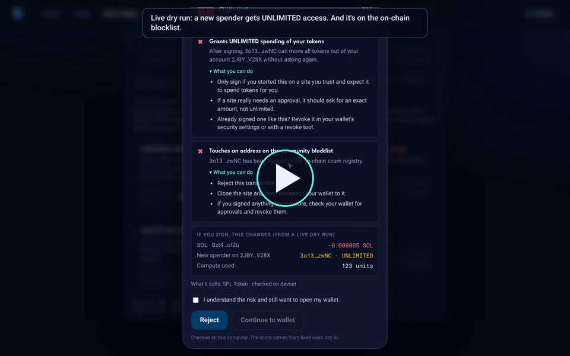

<p align="center">
  
</p>

<h1 align="center">Read Before You Sign</h1>

<p align="center">
  <b>Know what you sign, before you sign.</b><br>
  A Solana wallet guard that dry-runs every transaction, explains it in plain English,<br>
  and tells you what to do about the risky parts before your wallet even opens.
</p>

<p align="center">
  MLH Solana Hackathon (Nov 6–8, 2026) · <b>AI Track</b>
</p>

## 🎬 Demo

<p align="center">
  <a href="docs/demo.mp4"></a>
  <br><sub>▶ 1:30 demo: live devnet dry runs, the on-chain blocklist, and sandwich-attack protection</sub>
</p>

## 💡 The problem

Every Solana wallet popup asks you to trust a button. Drainer sites exploit
that: the button says **"Claim airdrop"**, but the transaction says *give this
stranger unlimited permission to spend your tokens*. On swaps, loose slippage
quietly hands money to **sandwich bots**. Wallets show a summary, but rarely
explain the dangerous part or what to do about it.

## ✅ What it does

| | |
| --- | --- |
| 🛡️ **Steps in before the wallet** | A Chrome extension catches sign requests from any Solana site (Phantom, Solflare, Backpack, any wallet-adapter site) and shows a review first. The wallet only opens if you click **Continue**. |
| 🔬 **Live dry run on Solana** | Simulates the transaction against real chain state and shows exactly what would change: balances, new spenders, new owners. |
| 🚩 **Flags real attack patterns** | Unlimited token approvals, token-account handovers, unknown programs, addresses on the community blocklist, swaps with no price protection. |
| 🥪 **Sandwich-attack exposure** | Reads the slippage from Jupiter and Raydium swaps: *"a bot could take up to 10%: you'd accept 135 instead of the quoted 150."* |
| 🧭 **Tells you what to do** | Every warning comes with **"What you can do"** steps, and every swap with a **"Protect your swaps"** checklist. |
| ⛓️ **On-chain scam registry** | A Rust/Anchor program on devnet stores a shared, auditable blocklist that every checker reads straight from Solana. |
| 🤖 **Plain-English explanations** | AI turns the findings into a short explanation. It can't change the score or call something safe. |

The same engine also powers a web checker, a **Trade** page that reads your
wallet through Helius, and an `rbys` command for the terminal.

## 🧠 How it works

```
 any Solana site asks your wallet to sign
                │
                ▼
 extension pauses the request ─► built-in analyzer
                │                 1. decode instructions (+ swap slippage)
                │                 2. simulate on Solana, diff accounts before/after
                │                 3. read the on-chain scam registry (Anchor program)
                │                 4. deterministic risk rules → score + flags + advice
                │                 5. AI rewords the findings (web app)
                ▼
 review panel:  [ Reject ]  [ Continue to wallet ] ─► wallet opens only if you continue
```

| Part | Where | What it is |
| --- | --- | --- |
| Browser extension | `extension/` | Manifest V3. `inject.js` wraps Wallet Standard and injected-provider signing, `bridge.js` draws the review panel, `src/background.ts` is the analyzer (bundled to `dist/`). |
| Analyzer engine | `app/src/lib/` | Decode, swap slippage, simulation diff, registry lookup, risk rules, guidance, AI wording. Shared by the extension, web app and CLI. |
| Web app + CLI | `app/` | Next.js 15 checker, Trade page and demo dApp; `rbys` terminal command with exit codes for scripts. |
| Scam registry | `programs/` | Rust/Anchor program with one PDA per flagged address, authority-gated writes, tests, and scripts for flagging addresses and building devnet demo transactions. |

## 🔗 How Solana and AI each do real work

**Solana does the detection.**
- **`simulateTransaction` against live chain state.** Every writable account
  is compared before and after (SPL token amount, delegate, owner), so findings
  reflect what the transaction *really* does, not what the site claims.
- **An on-chain program we wrote.** The scam registry
  ([`Be5rVJ…HkYcH` on devnet](https://explorer.solana.com/address/Be5rVJnyzJHtnAQKzim6wDGFFgEigJXb2pA7oZ9HkYcH?cluster=devnet))
  stores one PDA per flagged address. Any app can read the whole list with one
  `getProgramAccounts` call: shared, verifiable, composable.
- **Speed makes it practical.** A dry run returns in well under a second at no
  cost, so *every* transaction can be checked without slowing you down.
- **Native wallet integration** through the Wallet Standard.

**AI does the explaining, and only that.** The score and flags come from
deterministic rules plus the simulation. Claude receives those structured
findings and writes a short plain-English explanation. By design it **cannot
change the verdict or declare something safe**: a security tool shouldn't be
talked out of a warning.

## 🥪 Sandwich attacks

A bot spots your swap, buys just *before* you (pushing the price up), lets your
swap fill at the worse price, then sells just *after* you and keeps the
difference. **The bot can only take as much as your slippage allows**, and
slippage is written into the transaction, so Read Before You Sign reads it
before you sign:

| Swap setting | Result |
| --- | --- |
| Slippage ≤ 1% | ℹ️ shows the most a sandwich could take |
| Slippage > 1% | ⚠️ "High swap slippage invites sandwich attacks" |
| Slippage ≥ 5% | ⛔ high risk |
| Minimum out = 0 | ⛔ "No price protection" |

Every swap also gets the **Protect your swaps** checklist: keep slippage tight
(0.3–0.5% on big tokens), send privately (Jupiter Ultra, wallet MEV protection
or a Jito bundle), check price impact, use limit orders for big trades, and
avoid brand-new tokens in their first minutes. It doesn't stop the bot (that
happens after you sign); it shows your exposure and how to remove it before
you do.

## ⚡ Try it

**Extension only (no setup):** download `read-before-you-sign-extension.zip`
from [Releases](https://github.com/karlagisq/Read-Before-You-Sign/releases),
unzip it, open `chrome://extensions`, turn on **Developer mode**, click **Load
unpacked** and pick the folder. Click the shield icon to choose Devnet or
Mainnet. The checker is built in; nothing else needs to run.

**Full project:**

```bash
git clone https://github.com/karlagisq/Read-Before-You-Sign.git
cd Read-Before-You-Sign/app
npm install
cp .env.example .env.local   # optional: ANTHROPIC_API_KEY, HELIUS_API_KEY, REGISTRY_PROGRAM_ID
npm run dev                  # http://localhost:3000
```

**Live devnet demo:** with some devnet SOL in your Solana CLI wallet
([faucet](https://faucet.solana.com)), run `cd programs && npm install && npm run devnet-fixtures`.
It creates a test token and accounts in your wallet, and the Demo dApp
(`/demo` → *Use demo wallet* → *Live on devnet*) then shows real dry-run
results.

**Anchor program:** `cd programs && anchor build && anchor test`.

## 🔒 Privacy & security

- **Advisory only.** The extension holds no keys, can't sign, and never changes
  a transaction. It pauses or rejects; your wallet still asks you to approve.
- **Nothing leaves your computer** except the dry run to a Solana RPC, the same
  thing your wallet does for its own preview. Custom RPCs are opt-in per host.
- **Tamper-resistant panel:** closed shadow root, real clicks only, and the
  site's origin as Chrome reports it. High risk locks **Continue** until you
  confirm.
- **No secrets in the repo.** Keys stay in `.env.local`, and the Helius key
  stays server-side.

## 🛠️ Tech stack

Solana (`@solana/web3.js`, `@solana/spl-token`, Wallet Standard, wallet-adapter) ·
Rust + Anchor · TypeScript · Next.js 15 · Chrome Manifest V3 · esbuild ·
Helius · Claude (Anthropic API) · Figma

## 🚧 Limitations & next steps

**Limits:** address-lookup-table accounts aren't resolved yet; slippage is read
for Jupiter v6 and Raydium AMM v4; the registry is authority-gated; a site
built specifically to evade the extension could bypass it (true of every wallet
guard).

**Next:** an approvals scanner with one-click revoke, lookup-table support,
more DEX decoders, dollar values for every amount, sign-message review, open
community reporting for the registry, and a Chrome Web Store release.
